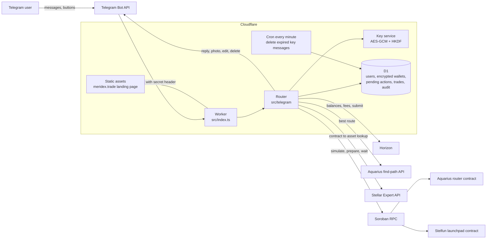
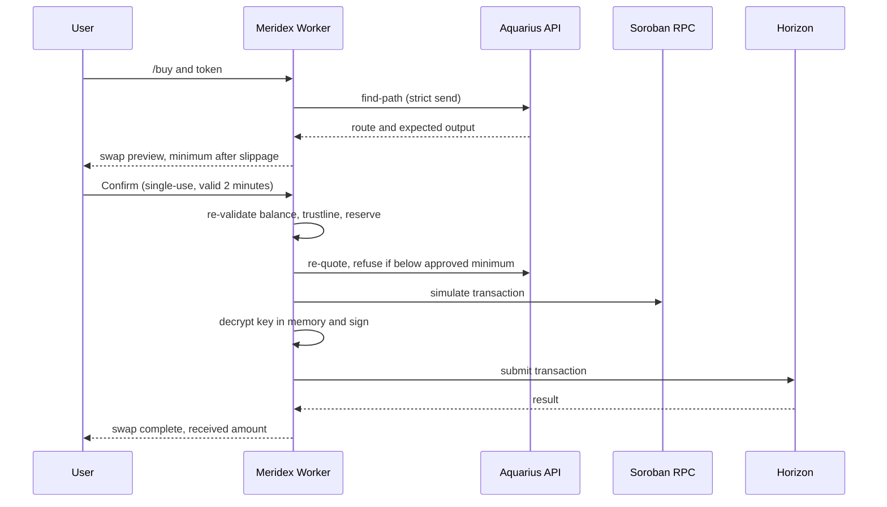

# Meridex architecture

Meridex is one Cloudflare Worker plus a D1 database. Telegram talks to it over a webhook; the Worker talks to Stellar (Horizon and Soroban RPC), the Aquarius router and the Stelfun launchpad contract.

## System overview

## Swap flow (confirmed by the user)

## Components

| Component | Responsibility | Code |
|---|---|---|
| Worker entry | Webhook auth (secret header and path), replay protection, cron | `src/index.ts` |
| Router | Commands, callbacks, confirmation flows, message layout | `src/telegram/` |
| Key service | Per-wallet key from `MASTER_KEY` + salt (HKDF-SHA256), AES-256-GCM with AAD | `src/crypto/keys.ts`, `src/service.ts` |
| Database | Users, wallets, pending actions (single-use), rate limits, audit log, trades | `src/db/`, `migrations/` |
| Stellar clients | Accounts, fees, transaction build and signing, Soroban simulate and submit | `src/stellar/` |
| Swaps | Route lookup, swap arguments, minimum output, market data | `src/aqua/`, `src/telegram/trade.ts` |
| Launchpad | Bonding-curve quotes, buy and sell calls | `src/stelfun/`, `src/telegram/launchpad.ts` |

## Trust boundaries

- The Worker is the only component that ever sees a plaintext private key, in memory, for the length of one signing call.
- D1 holds only encrypted keys. Without `MASTER_KEY` (a Worker secret) they cannot be decrypted.
- Telegram, Horizon, Soroban RPC, Aquarius and Stellar Expert are external and untrusted; every amount, balance and trustline is re-checked at confirmation time.

Planned changes (see the roadmap in the README): KMS-backed master key with rotation, more liquidity venues behind a provider interface, resolution of contract addresses through Soroban RPC instead of a third-party lookup.
